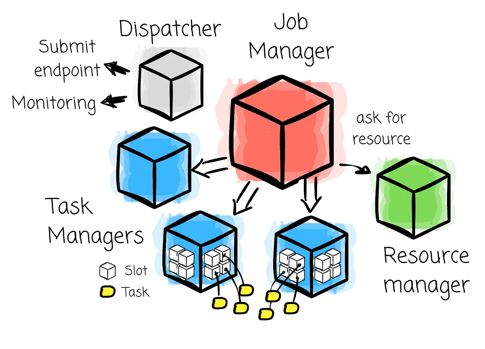
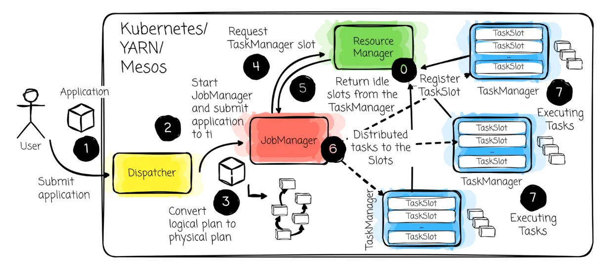
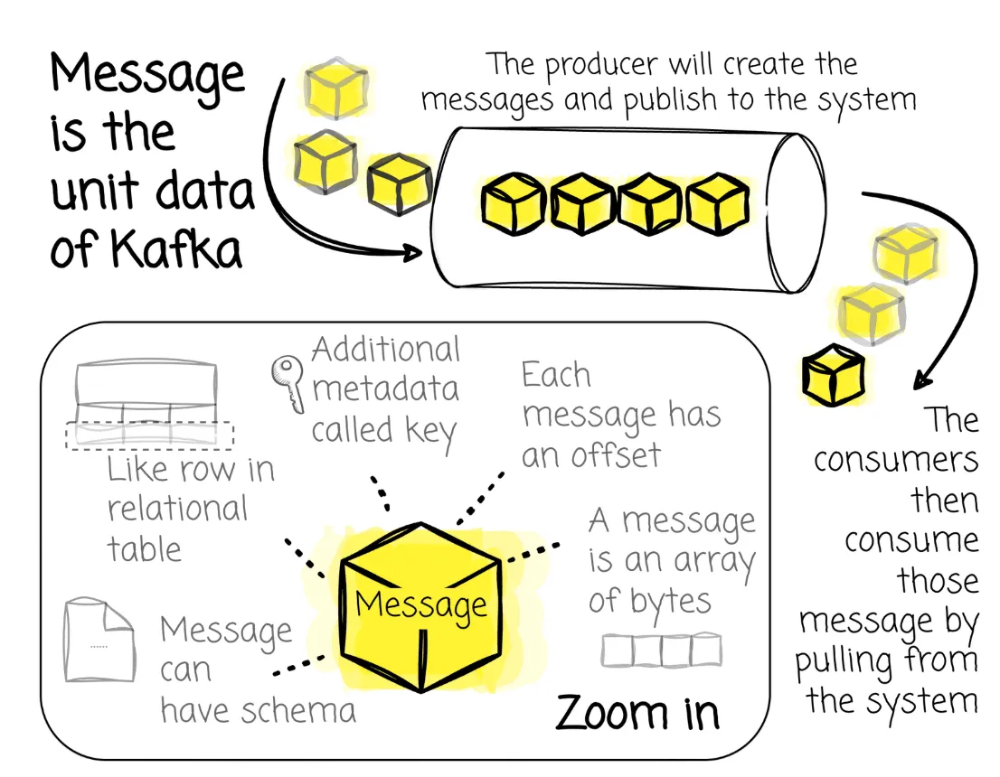
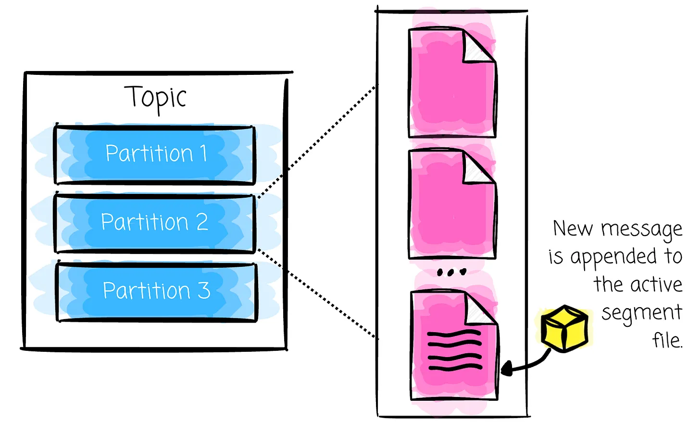
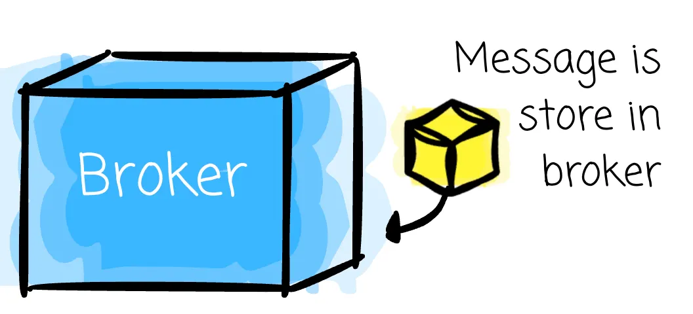
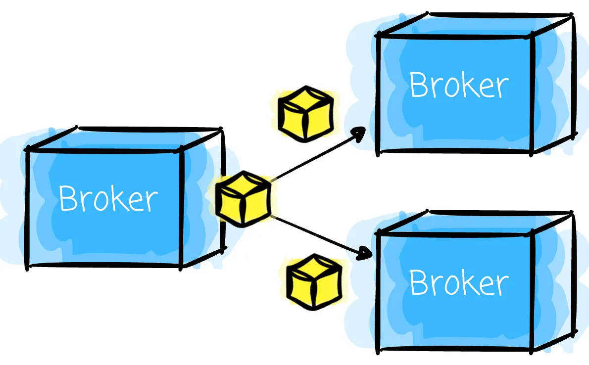

# Stream Processing Concepts

## The difference

### Definition

> Batch vs stream processing

In batch processing, you gather the data over a period (can be an hour, a day, 3 days, or a week of data) and then process it in a single operation. For example
- You read and process a Parquet file and then write the results somewhere.
- You take a snapshot of an OLTP database, transform it with SQL, and load it into the OLAP database.

For stream processing, most of the data is unbounded: from the user interaction on the website to data from IoT sensors.

### Data operations and fault tolerance

When a database does aggregation and joins, it comes down to looking for records with the same key
- With batch processing, the searching scope is defined. This makes the system know when the searching is done, thus finishing the aggregation or join.
- With stream processing, aggregation and joins have, in theory, an infinite search space, which requires us to apply techniques (windowing and watermarks) to limit it temporarily.

Regarding fault tolerance
- You reload the batch data from the source (if the batch is still available). Typically, you reprocess the entire batch, not part of it.
- In stream processing, things are different: you need to know which stream position to restart processing from, and the source must be able to “replay” the data stream from that position.

### Performance

In a batch, the performance of the processing is usually defined by:
- The data volume? 100GB, 1TB or 10TB
- How long does processing take? 1 hour, 2 hours or 12 hours

Typically, these two define and identify a less straightforward factor: your required **throughput**. It is a rate your system needs to maintain: records per second, gigabytes per hour, or terabytes per day. In batch processing, throughput is the metric that helps you estimate resource usage. Processing 1TB of data in 20 hours is different from processing it in 30 minutes.

In stream processing, the time window is not clear here. Now, we have two constraints:
- **Latency**: how fast does each record need to be processed? A fraud detection system might need a decision within 100 milliseconds. A near-real-time dashboard might tolerate a 30-second delay.
- **Throughput**: because data is now a continuous flow, the throughput is not static as in batch processing. For example, Black Friday could result in more user interaction on the website, which definitely 10x or 20x the data flow per unit of time.

Latency and throughput have a relationship
- Lowering latency tends to increase throughput; if the system processes a record faster, it can handle more records at the same time.
- A concern here is that a stream processor rarely processes a single record at a time. Each record incurs the costs of serialization, network transfer, disk I/O, and function calls, regardless of how small the record is. So, most of the stream processors (e.g., Flink) small batch those records (say 100 milliseconds) and process them once. But the tradeoff is the latency. Every record now has to wait a bit before it gets processed.

## The concepts behind nearly every stream processing system

### Time

In stream processing, there are two kinds of time:
- **Event Time**: the time the event itself happened. For example, if the system recorded you purchasing a game item at 12:30, this is considered the event time.
- **Processing Time**: The time at which an event is observed at any given point during processing. For example, the purchased game item is recorded at 12:30 but only arrives at the stream processing system at 12:35; this “12:35“ is the processing time.

A note is **processing time always comes after event time**. In fact, logging the time at which the event actually happens is nearly impossible. That said, the time the system assigns to an event, when observed, is widely accepted. Event time doesn’t change. It can be considered absolute. In contrast, processing time varies with each step in the process.

### Watermarks

The gap between the event and the processing time is called time skew. A **watermark** is a way to measure the skew. The watermarks tell the system that **“no more data that has an event time earlier than this time will arrive.”** If the watermark is X, the system **can assume that no events with a timestamp less than X will appear**.

### Windowing

**Windowing** is another way to limit search space in stream processing. It divides the infinite stream into finite chunks. Usually, the system uses time notions (usually the event time) to organize data into the window.

Three major types of windows:
- **Fixed (Tumbling)**: The windows are defined as a static window size, e.g., hourly windows.
- **Sliding**: The windows are defined by a window size and slide period, e.g., 30-minute windows starting every five minutes.
- **Session**: The windows capture some period of activity over a subset of the data, in this case, per key. Typically, they are defined by a timeout gap.

To better grasp the idea of a session window, take an example: imagine you’re tracking user interactions on a website. You’d like to know how many pages a user visited in a single browsing session. You set a session window with a 10-minute gap:
- **10:00:00**: User clicks on the homepage. This is the **first event**, which **starts a new session window**. The window’s end time is set to 10:10:00.
- **10:05:00**: User clicks on a product page. This event arrives within the 10-minute inactivity gap of the previous event. The window **expands to include this event**, and its end time is set to 10:15:00.
- **10:08:00**: User adds the product to their cart. This event is also within the gap. The window **expands again**, and its end time is reset to 10:18:00.
- **10:25:00**: User performs no activity for more than 10 minutes and then returns and clicks on the checkout page. This gap (from 10:08 to 10:25) **exceeds the 10-minute inactivity gap**. The session window that started at 10:00:00 is now **finalized**. This checkout event **starts a new session window**, with its end time set to 10:35:00.

### Triggers

Windowing helps divide the stream into batches. However, the system requires a signal to indicate that the window is ready for processing. This is where the trigger comes in. A **trigger** determines when the results of a windowed aggregation should be computed and emitted.

Several trigger types:
- **Event-time trigger**: It fires based on the event time's progress. This type is typically implemented with the watermark. A trigger at watermark 10:10 means “go on and do the calculation; no event sooner than 10:10 will arrive“.
- **Process-time trigger**: It fires at the point in processing time.
- **Data-arriving characteristics trigger**: Triggering based on factors such as counts, bytes, data punctuations, pattern matching, etc.
- **Composite trigger**: A mix of some of the above triggers.

#### Event-time trigger example

- With a fixed 10-minute window and an event-time trigger, data occurring between 1:05 and 1:15 will belong to that window. The window is triggered when the event time passes 1:15. But the question is “How do I know that data with event time less than 1:15 has all arrived?“
- This is the purpose of the watermark. In this case, the system waits for the watermark to advance to 1:15 to trigger the window safely.

#### Late event

- In the example above, data with event times between 1:05 and 1:15 that occur after the watermark has reached 1:15 are considered late and are dropped by default. However, in most streaming frameworks, we can define a grace period to allow for late data.
- The late boundary is relative to the watermark. Back to the example above with the 1:05 - 1:15 window, assume we allow the event to be 1 minute late; the watermark will form the late boundary at 1:16 (1:15 + 1 min) past the event time, plus the associated processing time. If the data has an event time between 1:05 and 1:15, it will be accepted if it arrives after the watermark passes the end of the window (1:15) but still below the late boundary.

## Stream Processor

To learn a stream processor, at the moment, no better choice than Flink. There are two areas you need to learn here: the stream processing logic and the infrastructure.
- For the first, keep all the concepts above and use them to learn how you express your stream processing in Flink. Read the official documentation from Flink and write the first stream processing app in Python (or Java).
- For the latter, two worth articles are [Apache Flink Overview](https://vutr.substack.com/p/apache-flink-overview) and [I spent 8 hours understanding which factors make Flink a robust stream processing engine](https://vutr.substack.com/p/i-spent-8-hours-understanding-which).

### Component

It also has the coordinator-workers set up, but with a different name:

- The **Dispatcher** provides a REST interface for users to submit Flink applications. It also runs a dashboard to display information about job executions.
- The **JobManager** is the master that controls the execution of a Flink application; a different JobManager controls each application. (like the Driver in Spark)
- Flink has different **ResourceManagers** for different resource providers, such as YARN or Kubernetes. This component’s primary responsibility is to manage TaskManager slots, Flink’s processing unit. (like Cluster Manager in Spark)
- **TaskManagers** are Flink worker processes. There are multiple TaskManagers for a Flink setup. Each provides some slots. Each task is executed on a slot, and the number of tasks a TaskManager can handle is capped by the number of slots. (like the executors in Spark)

Here is a typical flow of a Flink application:

- An application is submitted to the Dispatcher.
- The Dispatcher starts the JobManager.
- When the JobManager receives an application, it converts the logical plan into the physical one, which includes tasks that can be executed in parallel.
- After that, the JobManager asks the resource managers for resources (TaskManager slots).

    > When a TaskManager first starts, it registers its slots to the Resource Manager.

- The ResourceManager instructs the TaskManager with idle slots and offers them to the JobManager. If the ResourceManager does not have enough slots to fulfill the JobManager’s request, it communicates to a resource provider to initiate more TaskManager processes.
- After the JobManager has the information about the slots, it assigns tasks to the TaskManager slots.
- TaskManagers start executing the task.
- During execution, the JobManager is also responsible for all actions that require central coordination, such as checkpointing.

TaskManagers provide a defined number of slots to control the number of parallel tasks. (like task slots in the Spark executor; by default, a task is handled by a single CPU core; if an executor has 4 CPUs, we say it can handle 4 tasks at the same time)

### State

State is simply a variable that needs to be updated and maintained. The logic of reading and writing the state is straightforward; however, managing the state efficiently is more challenging due to Flink's distributed nature.

Flink offers different state backends that define how and where the state is stored. Some options that can be listed are Java’s heap/off-heap memory or RocksDB.

To learn about state, the best way is to start with stateful aggregation in Flink, which is one of the most common computations: aggregation, sum, or count.

### Checkpointing

Flink achieves fault tolerance by allowing the state and stream positions to be recovered without restarting from the beginning. The most naive approach is: 
- Pausing the application
- Checkpointing the current processing stream position
- If a failure occurs, resume from where the application failed using the information from the checkpoint

However, this approach is impractical; it requires the whole pipeline to stop before checkpointing, resulting in higher latency. So, Flink must take a different approach.

It uses the Chandy-Lamport algorithm, which uses a special record called a checkpoint barrier. The JobManager creates the barrier and injects it into the data stream. The barrier contains a checkpoint ID to define the checkpoint it belongs to and split the stream into two parts:
- Preceded-barrier state modifications belong to this checkpoint.
- Followed-barrier state modifications are associated with the next checkpoint.

The details of the Flink checkpoint process in [here](https://vutr.substack.com/p/i-spent-8-hours-understanding-which?open=false#%C2%A7checkpoint-process).

## Absorbing the stream

For any data stream, you must have a mechanism to capture, buffer, distribute, and replay it. Just imagine you feed the data stream directly to Flink. The most common tool for this purpose is Kafka.

To learn about the Kafka fundamentals, see [If you're learning Kafka, this article is for you](https://vutr.substack.com/p/if-youre-learning-kafka-this-article).

### Message

A message is a data unit in Kafka. It is simply an array of bytes. One can have an optional metadata key.

### Topic and Partitions

Messages in Kafka are organized into topics. A topic can be divided into partitions.

Partitions are how Kafka offers redundancy and scalability. Each partition can be hosted on a different server, meaning a topic can be scaled horizontally across servers.

Each partition of a topic corresponds to a logical log. Physically, a log is implemented as a set of segment files of approximately equal size (e.g., 1GB each). Whenever a message is written to the partition, the broker appends that message to the active segment file.

### Brokers

The published messages are stored at a set of servers called brokers, which receives messages from producers (the clients that write messages), assigns offsets to them, and writes them to disk. They also serve consumers (the clients that read messages) by responding to the message fetch requests.

Kafka brokers work as part of a cluster. One broker will act as the cluster controller within a cluster. The controller is responsible for administrative operations.

In Kafka, replication provides redundancy for messages within a partition, so that one of the followers can assume leadership if a broker fails.

- All producers must talk to the leader to publish messages, but consumers can fetch from either the leader or one of the followers.
- There is a single broker in the cluster that owns a partition. This broker is called the partition’s leader. Replicated partitions are assigned to other brokers, called the followers.

## Hands-on project

- **Phase 1**: Just pick a problem you want to solve, and make a runnable MVP:

    - Kafka and Flink run on containers.
    - A Python producer that sends the message to Kafka.
    - A Python Flink application that reads the Kafka message and applies some simple transformation: enrich a field or filter something. The note is that you don’t want stateful aggregation at this stage.
    - The result is written to your choice of destination. MongoDB, Clickhouse, Druid, Pinot, or whatever you prefer.
    - Add a dashboard on top to actually see the number update in real-time.

- **Phase 2**: learn about fault tolerance and performance optimization.

    - Try to break the Flink application, then restart it to see whether it can return to its last processing state.
    - Put more constraints on your application: X latency and Y throughput, and tune some configuration or add more resources to optimize for the target requirement.

## References

- [How to start learning stream processing from zero?](https://vutr.substack.com/p/how-to-start-learning-stream-processing)